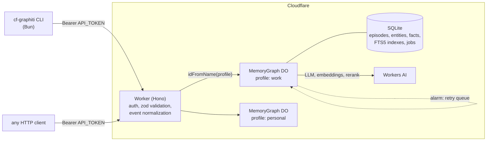
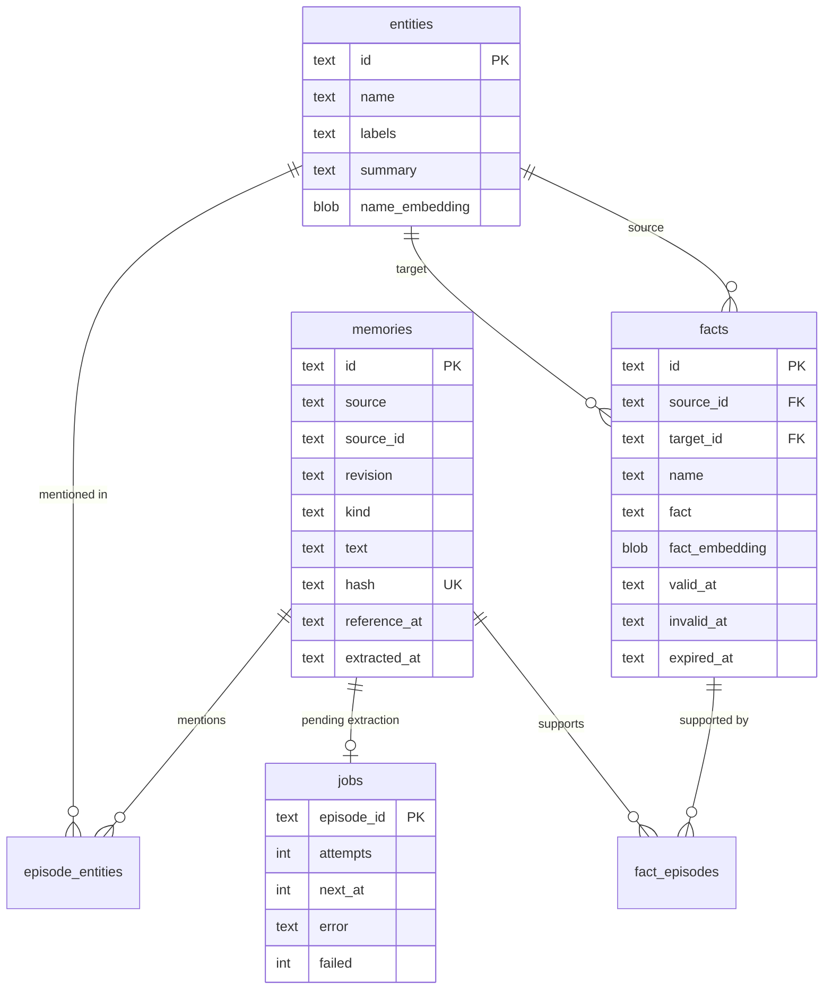
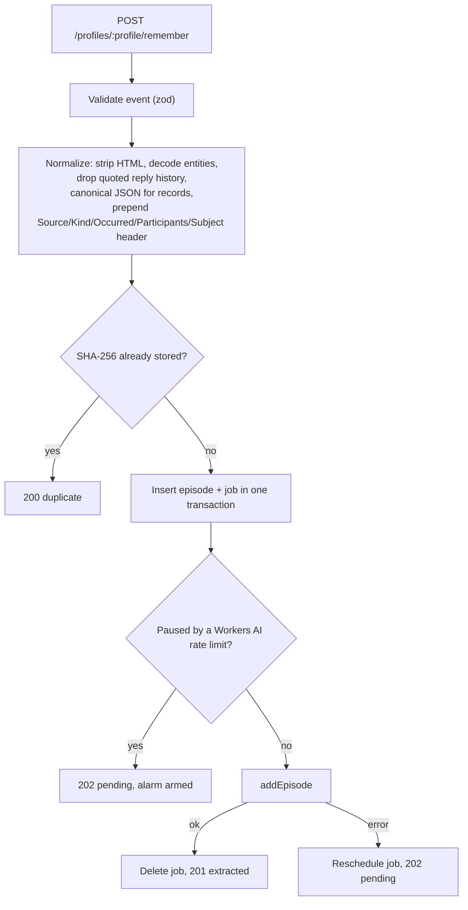
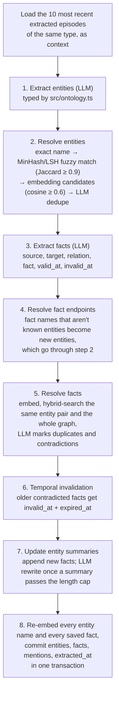
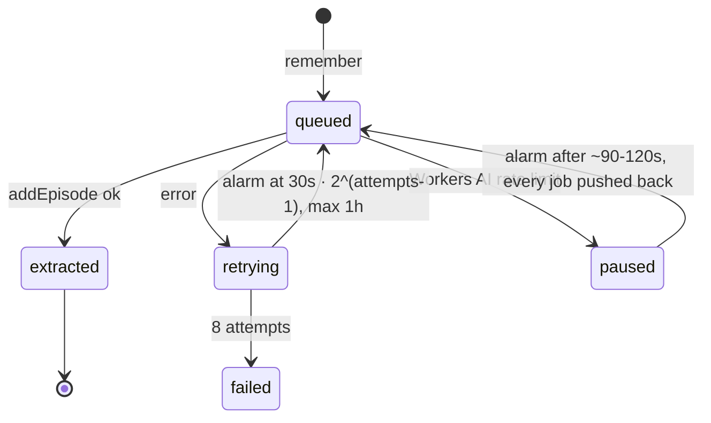
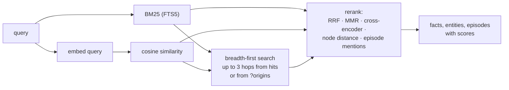

# cf-graphiti

A temporal knowledge-graph memory that runs entirely on Cloudflare. It is a TypeScript port of [Graphiti](https://github.com/getzep/graphiti)'s `add_episode`, `search_` and `remove_episode` pipelines. Graphiti needs Neo4j and OpenAI; this port uses a Worker, one SQLite-backed Durable Object per memory profile, and Workers AI.

You send it events: emails, notes, transcripts, CRM records. An LLM extracts entities and facts from each event, merges them with what the graph already knows, and records when each fact became true and when it stopped being true. Search combines full-text, vector similarity and graph traversal, then reranks the results.

## Architecture



| Piece | Where | Role |
|---|---|---|
| Worker | `src/index.ts` | Hono routes, bearer auth, request validation, routes each profile to its Durable Object |
| `MemoryGraph` Durable Object | `src/graph.ts` | One per profile. Serializes writes, owns the retry queue and alarm |
| Store | `src/store.ts`, `src/schema.ts` | Durable Object SQLite, schema migrations, in-memory vector cache, brute-force cosine search |
| Ingest | `src/ingest.ts`, `src/dedup.ts`, `src/temporal.ts` | Graphiti `add_episode` and `remove_episode` |
| Search | `src/search.ts`, `src/fts.ts` | Graphiti `search_` with all of its recipes and rerankers |
| Prompts | `src/prompts.ts`, `src/ontology.ts`, `src/pyformat.ts` | Graphiti prompts and response schemas, entity types, Python-compatible timestamp formatting |
| LLM | `src/llm.ts` | Workers AI calls with a concurrency limit, rate-limit backoff and schema-repair retries |
| CLI | `cli/cf-graphiti.ts` | Command-line client for the HTTP API |

Models (`src/llm.ts`):

| Use | Workers AI model |
|---|---|
| Extraction, deduplication, summaries | `@cf/deepseek-ai/deepseek-v4-flash-0731` (JSON schema output) |
| Embeddings | `@cf/google/embeddinggemma-300m` |
| Cross-encoder rerank | `@cf/baai/bge-reranker-base` |

## Data model

An **episode** is one stored event. **Entities** are the nodes, and **facts** are the edges between them. Every fact carries a validity window and links back to the episodes that support it.



FTS5 tables (`memories_fts`, `entities_fts`, `facts_fts`) stay in sync through triggers. Embeddings are Float32 blobs. A store loads them into memory on first use and drops the cache on every write.

There are three timestamps on a fact:

| Field | Meaning |
|---|---|
| `valid_at` | When the fact became true in the world |
| `invalid_at` | When it stopped being true |
| `expired_at` | When the graph learned it was no longer current |

`GET /graph` and `cf-graphiti graph` hide facts with an `expired_at` unless you ask for them. Search does not filter them, matching Graphiti; check `expiredAt` on each result.

## Writing: `POST /remember`



### Event shape

```json
{
  "source": "gmail",
  "sourceId": "18c2f0a9e1",
  "revision": "1",
  "kind": "message",
  "occurredAt": "2026-10-30T09:15:00Z",
  "participants": [{ "name": "Alice Smith", "role": "sender" }],
  "subject": "Renewal",
  "body": "We're moving to the Pro plan from next month."
}
```

| Field | Rule |
|---|---|
| `source` | Lowercase slug, for example `gmail`, `hubspot`, `cli` |
| `sourceId`, `revision` | The item's ID in its source system, and its version. A new revision is a new episode |
| `kind` | `message`, `transcript`, `note`, `document`, `record`. A `record` body must be a JSON object; every other kind takes text |
| `occurredAt` | ISO datetime with an offset. At most 5 minutes in the future |
| Size | At most 200,000 characters after normalization |

`kind` selects the extraction prompt: `message` and `transcript` use Graphiti's message prompt, `record` the JSON prompt, and `note` and `document` the text prompt.

### `addEpisode` pipeline



Steps 1, 2, 3, 5 and 7 call the LLM. Fact timestamps the LLM can't read from the episode text come from a separate timestamp prompt. For facts that state a future action ("will", "plans to", "scheduled to"), `src/temporal.ts` clamps `valid_at` to the episode time and ignores a deadline used as an end date.

Contradictions between facts are resolved by validity time. For example:

| Episode | Fact | Result |
|---|---|---|
| 2026-09-01 | Alice works at Acme | `valid_at 2026-09-01` |
| 2026-10-15 | Alice joined Globex | New fact `valid_at 2026-10-15`; the Acme fact gets `invalid_at 2026-10-15` and `expired_at` set to now |

### Retries and rate limits

Every Workers AI call goes through `runAi`: at most 3 concurrent calls per isolate, with rate-limit backoff of 2, 5, 12 and 25 seconds. Timeouts, connection failures and 5xx errors are retried twice with exponential backoff. Before each call, input text is cleaned of zero-width characters, control characters and broken surrogates, as Graphiti's `_clean_input` does. Responses must match a strict JSON schema; when one doesn't, the error goes back to the model up to 2 more times. Refusals, exhausted rate-limit retries and transport failures are not retried this way.

If extraction still fails, the episode stays stored and its row in `jobs` is rescheduled:



The Durable Object alarm fires at the earliest `next_at` and works through due jobs in order. During a rate-limit pause, new episodes are stored and queued without calling the LLM. `GET /status` lists the pending and failed jobs.

## Reading: `GET /search`



Facts, entities and episodes are searched in parallel. Each recipe picks the methods and the reranker for each of the three:

| Recipe | Facts | Entities | Episodes |
|---|---|---|---|
| `combined_hybrid_search_cross_encoder` (default) | BM25 + cosine + BFS, cross-encoder | BM25 + cosine + BFS, cross-encoder | BM25, cross-encoder |
| `combined_hybrid_search_rrf` | BM25 + cosine, RRF | BM25 + cosine, RRF | BM25, RRF |
| `combined_hybrid_search_mmr` | BM25 + cosine, MMR | BM25 + cosine, MMR | BM25, RRF |
| `edge_hybrid_search_{rrf,mmr,node_distance,episode_mentions,cross_encoder}` | as named | none | none |
| `node_hybrid_search_{rrf,mmr,node_distance,episode_mentions,cross_encoder}` | none | as named | none |

`node_distance` recipes need `?center=<entity-id>`. `?origins=id,id` sets the BFS start points.

Vector search is a brute-force scan over an in-memory cache, which fits one profile per Durable Object. Breadth-first search follows every path of 1 to 3 hops from each origin over facts and episode mentions, without reusing an edge, as Graphiti's Cypher query does.

## Forgetting

`DELETE /episodes/:id` runs Graphiti's `remove_episode`. It deletes the episode, every fact supported only by that episode, and every entity mentioned only by it. Entities that are still mentioned elsewhere get their summaries rebuilt from their remaining episodes.

`DELETE /facts/:id` deletes a single fact.

## Parity with Graphiti

The ingest, search and forget paths follow [`graphiti_core`](https://github.com/getzep/graphiti/tree/main/graphiti_core) at commit `72b5c59` (2026-10-28) line by line: prompts render byte-for-byte the same, and constants, thresholds, call order, MinHash (BLAKE2b) dedup, temporal invalidation, summary rules, search recipes and rerankers match. Upstream quirks are kept on purpose, including invalidation candidates searched across the whole graph and expired facts returned by search.

Out of scope: sagas, communities, bulk ingest, `add_triplet`, custom edge types, and entity attribute extraction (the ontology types have no fields).

Deviations Cloudflare forces:

| Area | Upstream | Here |
|---|---|---|
| Graph store | Neo4j, Cypher, Lucene fulltext | Durable Object SQLite, FTS5 `unicode61` + `bm25()`, brute-force cosine over cached Float32 vectors. Some tokens split differently (`don't`, `3.14`) |
| Models | OpenAI chat with small/medium sizes, `text-embedding-3-small` | One Workers AI chat model for every call, `embeddinggemma-300m` |
| Cross-encoder | OpenAI yes/no reranker using logprobs | `bge-reranker-base`, passages cut to 2,000 characters |
| Rate limits | SDK retries twice | Retries 4 times (2, 5, 12, 25 s); at most 3 concurrent AI calls per isolate; embeddings in batches of 100 |
| Error types | Typed OpenAI exceptions | Workers AI error messages matched by text |
| `group_id` | Filters every query | One Durable Object per profile, so a profile is one group |
| Previous episodes | Only saved episodes exist | Episodes are stored before extraction, so the lookup skips unextracted episodes and the current one |
| Timestamps | Python datetimes, microseconds | ISO strings, milliseconds |

## HTTP API

All routes except `/health` require `Authorization: Bearer $API_TOKEN`. A profile name is 1 to 64 lowercase letters, digits and dashes. Each profile is a separate graph.

| Method | Path | Returns |
|---|---|---|
| `GET` | `/health` | `ok` |
| `POST` | `/profiles/:profile/remember` | `201` extracted, `202` pending, `200` duplicate, `422` rejected by normalization |
| `GET` | `/profiles/:profile/search?q=&recipe=&limit=&center=&origins=` | Scored `edges`, `nodes`, `episodes` |
| `GET` | `/profiles/:profile/graph?includeExpired=1` | All entities and facts |
| `GET` | `/profiles/:profile/entities/:nameOrId` | Entity, its facts, episodes and neighbours. Matches by ID, exact name, then substring |
| `GET` | `/profiles/:profile/episodes?limit=` | Episodes, newest `occurredAt` first |
| `GET` | `/profiles/:profile/status` | Counts and the job queue |
| `DELETE` | `/profiles/:profile/episodes/:id` | Remove an episode |
| `DELETE` | `/profiles/:profile/facts/:id` | Remove a fact |

## CLI: `cf-graphiti`

```sh
bun cli/cf-graphiti.ts remember "Alice moved to the Pro plan" --participant "Alice Smith:customer"
bun cli/cf-graphiti.ts remember --file notes/call.md --kind transcript --at 2026-10-30T09:00:00Z
bun cli/cf-graphiti.ts search "what plan is Alice on"
bun cli/cf-graphiti.ts graph "Alice Smith" --all
bun cli/cf-graphiti.ts status
bun cli/cf-graphiti.ts forget <episode-id>
```

Each setting comes from the flag, then the environment variable, then a file in `~/.config/cf-graphiti/`.

| Setting | Flag | Environment | File | Default |
|---|---|---|---|---|
| API base | `--url` | `CF_GRAPHITI_URL` | `url` | none, required |
| Profile | `--profile` | `CF_GRAPHITI_PROFILE` | `profile` | `default` |
| Token | | `CF_GRAPHITI_TOKEN` | `token` | none, required |

Add `--json` to any command to print the raw API response. Run `cf-graphiti --help` for every flag.

## Development

```sh
bun install
echo 'API_TOKEN=dev-token' > .dev.vars
bun run dev
bun run check
```

`bun run dev` runs `wrangler dev`. Workers AI is a remote binding, so even local runs make real model calls. `bun run check` regenerates the Worker types and typechecks both the Worker and the CLI.

Deploy:

```sh
bunx wrangler secret put API_TOKEN
bun run deploy
```

`wrangler.jsonc` has no `account_id`. Wrangler uses the logged-in account; if the login has more than one, set `CLOUDFLARE_ACCOUNT_ID`.

Schema changes go in `src/schema.ts` as a new entry in `migrations`. Each Durable Object stores its schema version and applies any missing migrations on startup.
